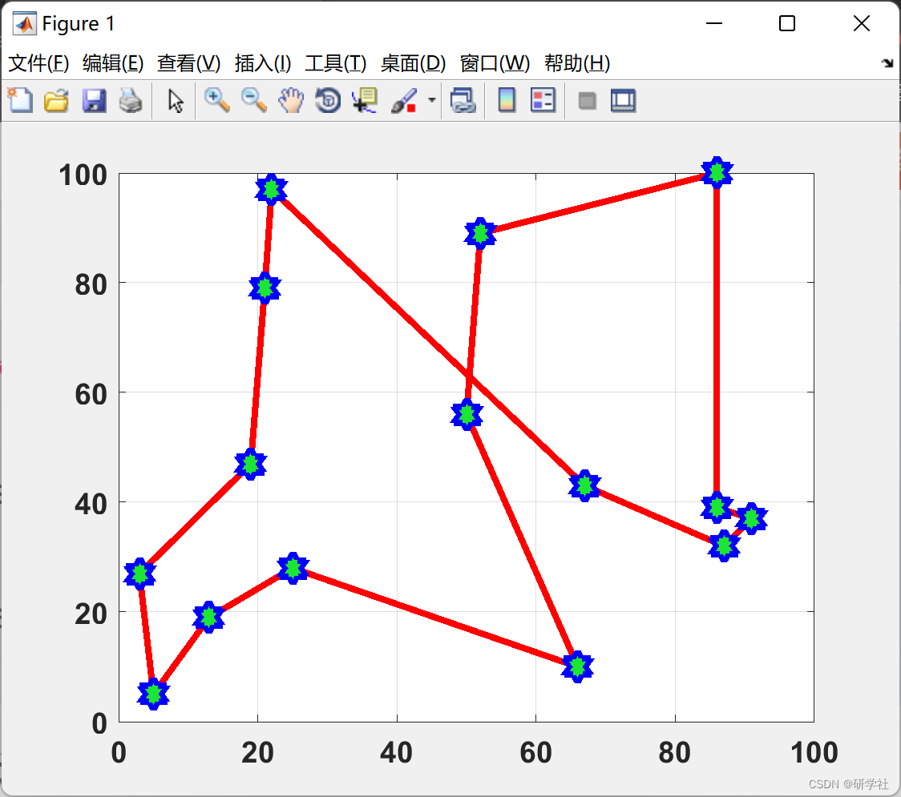
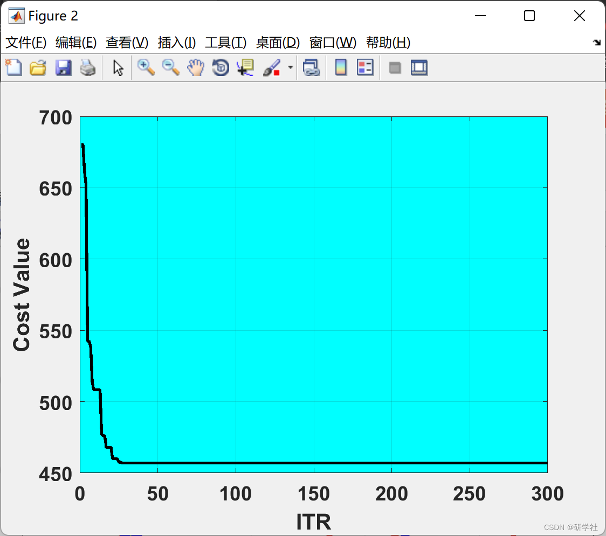

# Optimization Algorithm for Traveling Salesman Problem Based on Weevil Worm Damage (Matlab Code Implementation)

🏆 Bloggers' Advantage: 🌞🌞🌞 The content of the blog strives to be rigorous in thought and clear in logic, for the convenience of readers.
⛳️ Mantra: "Those who travel a hundred miles may arrive at the ninety-ninth mile." 📜
💥1 Overview The Weevil-eating beetle is an insect with a long, thin nose, belonging to the Curculionoide superfamily and containing approximately 97,000 species. Most believe that pests cause environmental damage, but some species, such as the wheat earworm, corn earworm, and cotton bollworm, are notorious for causing significant damage to crops, especially grains. This study proposes a new swarm-based metaheuristic algorithm, called the Wandering Ant Disturbance Optimization Algorithm (WDOA), which simulates the flying ability of ants, their nose strength, and their ability to damage crops or agricultural products. The proposed algorithm was tested with 12 benchmark single-peak and multi-peak artificial landscapes or optimized test functions. Furthermore, the proposed WDOA is used for five engineering problems to check its robustness in solving the problems. The problems include the Traveling Salesman Problem (TSP), n-Queens problem, portfolio problem, Optimal Inventory Control Problem (OIC) and Bin Packing Problem. All the tested functions were compared with benchmark algorithms such as Particle Swarm Optimization (PSO), Genetic Algorithm (GA), Harmony Search (HS) algorithm, Imperial Competitive Algorithm (ICA), Firefly Algorithm (FA) and Differential Evolution (DE) algorithm. Furthermore, all problems were tested with DE, FA and HS algorithms. The proposed algorithm showed robustness and speed in all functions and problems by providing precision and reasonable speed.
Editor
Then this paper solves the TSP problem based on the optimizing algorithm of ant damage, and realizes it with Matlab code.
📚2 Running Results Editing
Editor
Part of the code:
%% Problem  
model=MakeModel3();  
CostFunction=@(s) CostF(s,model);    % Cost Function  
nVar=model.n;      % Number of Decision Variables  
VarSize=[1 nVar];    % Decision Variables Matrix Size  
VarMin=0;        % Lower Bound of Variables  
VarMax=1;        % Upper Bound of Variables  
%% WDOA Parameters  
MaxIt = 300;     % Maximum Number of Iterations  
nPop = 50;      % Number of weevils  
DamageRate = 0.3;         % Damage Rate  
nweevil = round(DamageRate*nPop); % Number of Remained weevils  
nNew = nPop-nweevil;        % Number of New weevils  
mu = linspace(1, 0, nPop);     % Mutation Rates  
pMutation = 0.2;          % Mutation Probability  
MUtwo = 1-mu;           % Second Mutation  
SnoutPower = 0.8;         % Weevil Snout power Rate  
FlyPower = 0.03*(VarMax-VarMin);  % Weevil Fly Power Rate  
%% Basics  
% Empty weevil  
weevil.Position = [];  
weevil.Cost = [];  
weevil.Sol = [];  
% Weevils Array  
pop = repmat(weevil, nPop, 1);  
% First weevils  
for i = 1:nPop  
pop(i).Position = unifrnd(VarMin, VarMax, VarSize);  
[pop(i).Cost pop(i).Sol] = CostFunction(pop(i).Position);  
end;  
% Sort  
[~, SortOrder] = sort([pop.Cost]);pop = pop(SortOrder);  
% Best Solution  
BestSol = pop(1);  
% Best Costs Array  
BestCost = zeros(MaxIt, 1);  
%% WDOA Body  
for it = 1:MaxIt  
newpop = pop;  
for i = 1:nPop  
for k = 1:nVar  
if rand <= MUtwo(i)  
TMP = mu;TMP(i) = 0;TMP = TMP/sum(TMP);  
j = RouletteWheelS(TMP);  
newpop(i).Position(k) = pop(i).Position(k)+SnoutPower*(pop(j).Position(k)-pop(i).Position(k));  
end;  
% Mutation  
if rand <= pMutation  
newpop(i).Position(k) = newpop(i).Position(k)+FlyPower*randn;  
end;end;  
% Apply Lower and Upper Bound Limits  
newpop(i).Position = max(newpop(i).Position, VarMin);  
newpop(i).Position = min(newpop(i).Position, VarMax);  
[newpop(i).Cost newpop(i).Sol] = CostFunction(newpop(i).Position);  
end;% Asses power  
[~, SortOrder] = sort([newpop.Cost]);newpop = newpop(SortOrder);% Sort  
pop = [pop(1:nweevil);newpop(1:nNew)];% Select  
[~, SortOrder] = sort([pop.Cost]);pop = pop(SortOrder);% Sort  
BestSol = pop(1);% Update  
BestCost(it) = BestSol.Cost;% Store  
% Iteration  
disp(['In Iteration No ' num2str(it) ': WDOA Best Cost = ' num2str(BestCost(it))]);  
% Plot Res  
figure(1);  
Plotfig(BestSol.Sol.tour,model);  
end  
🎉3 References
🌈4 Matlab code implementation

## Images

<!-- PAYMENT_BLOCK -->

## Get this dataset

- Payment link (Stripe): [Buy now](https://buy.stripe.com/3cs8yP7sY87d0vu9AB)
- Payment QR code: 

<!-- /PAYMENT_BLOCK -->
